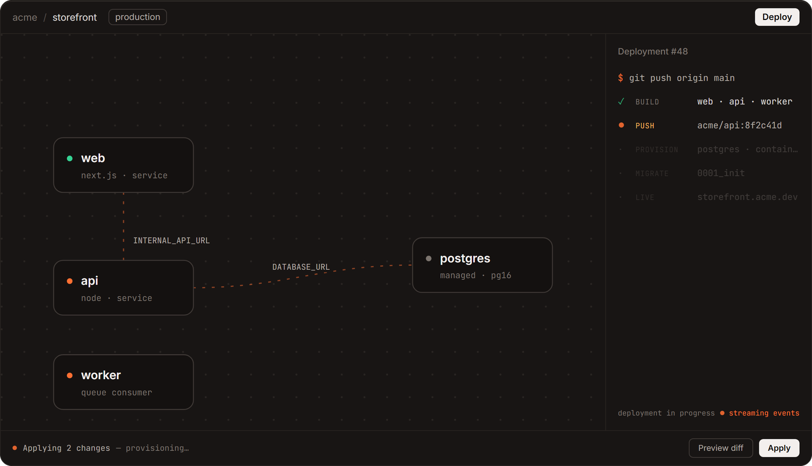

# Mohammad Aziz

Full stack engineer in Lahore, Pakistan. I've spent 5+ years building products end to end, twice as the founding engineer, and most of my work now is LLM systems that run in production: MCP servers, agent pipelines and evals.

[Website](https://mohammadaziz.me) · [LinkedIn](https://www.linkedin.com/in/mohdzez/) · [Email](mailto:mohammadazizramay@gmail.com) · [Resume](Mohammad_Aziz_Resume.pdf)

## Liftoff

**[tryliftoff.tech](https://tryliftoff.tech)** · Push code. Get infrastructure. Keep both.

My side project, built solo. You draw your services and databases on a canvas and push to GitHub. Your own GitHub Actions build the images, and Pulumi provisions everything into your own cloud account: DigitalOcean today, Azure in beta. Your cloud credentials never pass through Liftoff's servers, and the infrastructure stays yours if you disconnect.

The `liftoff-*` and `linkboard` repos pinned below are small demo apps I deploy on it to exercise the platform: multi-service canvases, managed Postgres and Redis, gated migrations, logs and metrics. Liftoff's own source isn't public yet. It's meant to be open source, and I want it stable at 1.0 first.

## Work

At Venturenox I work on **SarahAI**, an AI executive assistant for small businesses that runs on WhatsApp, voice and mobile. Some of what I've built there:

- An MCP server that routes model calls to fallback open-source models on Groq and Cerebras, picking by live latency and cost
- The move from Respond.io to Meta's WhatsApp Cloud API, done as a live hot swap with no downtime for users mid-conversation
- Durable agent workflows on Inngest, and time-based message delivery on AWS Lambda, SQS and EventBridge
- Prompt versioning and tracing in Langfuse across OpenAI, Gemini and Claude

Before that I was the first engineer at **Informly** (2023–2025). I took a business growth platform from an empty repo to paying enterprise customers, including an AI engine with graph-based tenant memory and LLM-as-judge evals, and a drag-and-drop workflow builder on Hatchet.

## Stack

Also Inngest, Hatchet, MCP, Langfuse and Pulumi.

Email is the quickest way to reach me.
